Saat melaksanakan tugas kelompok ini saya menggunakan AI Claude untuk membantu saya dengan beberapa hal. Hal tersebut bisa dikelompokkan sebagai kategori berikut:
1. Pembuatan code frontend dari design figma yang sudah ada
2. Pencarian error pada code
3. Membantu implementasi ide yang aku punya

# Pembuatan code frontend dari design figma
Figma menyediakan fitur dimana bisa langsung mengambil code dari design yang dibuat. Namun, fitur ini ada banyak batasannya, yang paling penting itu staticnya dimana elemennya tidak memiliki interaktivitas. Selain itu, design ini rawan untuk memiliki conflict dengan code yang sudah ada. Saya menggunakan Claude dengan mengirim code hasil figma dengan template & css awal untuk menggabungkannya biar tidak ada conflict. 
Contoh:
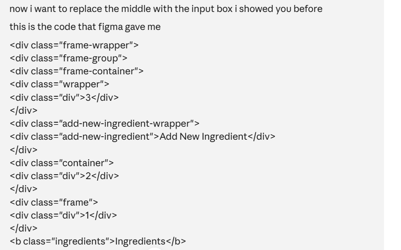
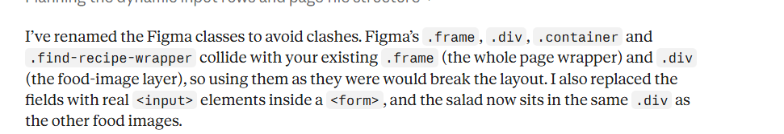

# Pencarian error pada code
Seringkali ada error yang muncul pada code yang aku buat dan aku tidak tahu asalnya dari mana. Saya memberikan codenya dan pesan errornya kepada Claude untuk menemukan dimana kesalahannya terjadi. 
Contoh frontend:
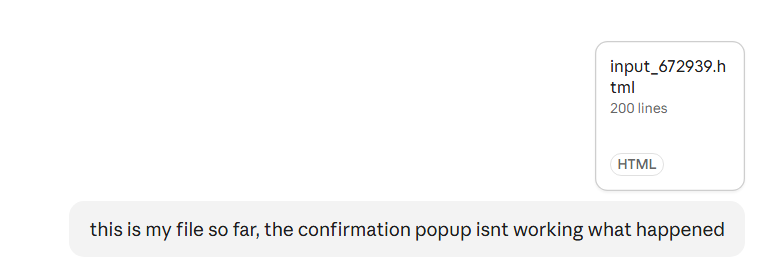
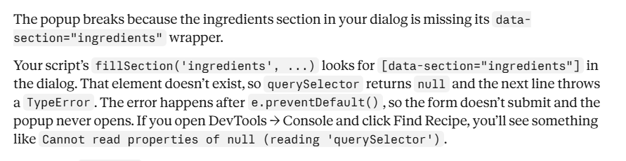
Contoh backend:
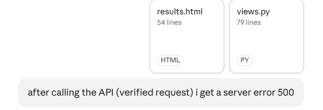
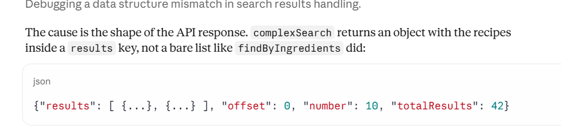

# Membantu implementasi ide yang aku punya
Saya tidak menghafal semua sintaks, jadi jika aku ada ide tetapi aku tidak tahu cara implementasinya saya akan menanya Claude bagaimana idenya bisa diimplementasi.

Contoh frontend:
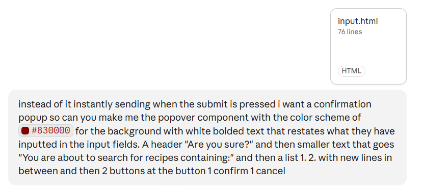
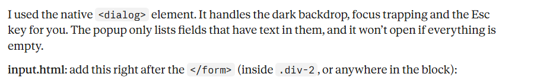

Contoh backend:
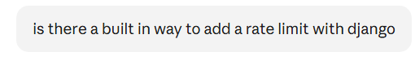
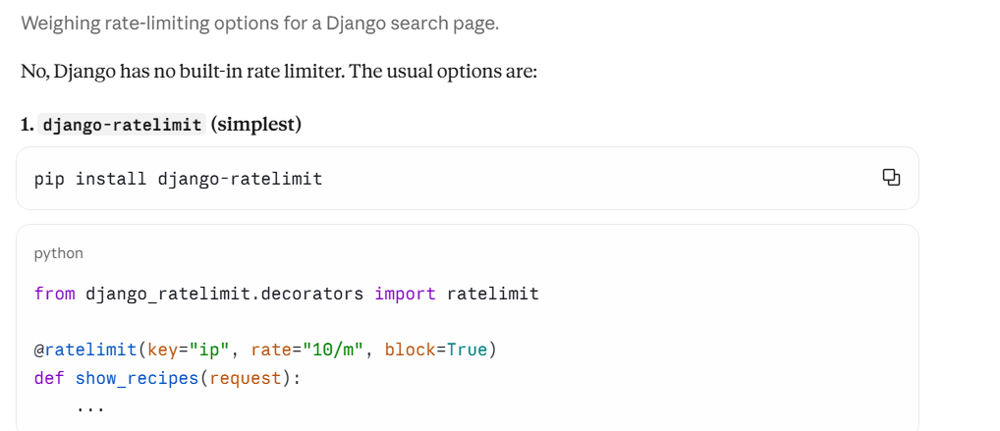

# Others
Selain kategori itu, saya juga menggunakan Claude untuk membantu aku di hal lain.
1. Pembuatan unit testing menggunakan selenium: Aku awalnya ingin menggunakan django testing tetapi htmxnya tidak ke load jadi aku kirim yang aku udah mengidekan dan minta Claude untuk merubahnya menggunakan Selenium
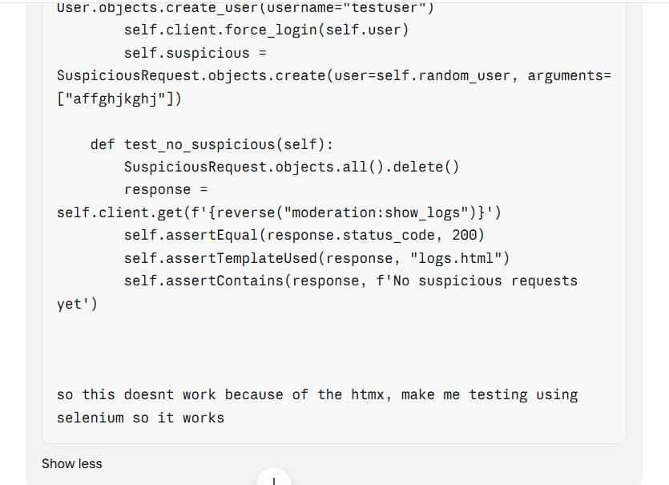
2. Implementasi htmx: Aku ingin mengimplementasi htmx dibandingkan ajax karena keliatannya lebih enak jadi aku mengambil inspirasi dari html review list dan meminta mengubah menjadi htmx biar saya bisa ganti-ganti. Saya juga minta Claude untuk membuat hal yang aku pikirkan.
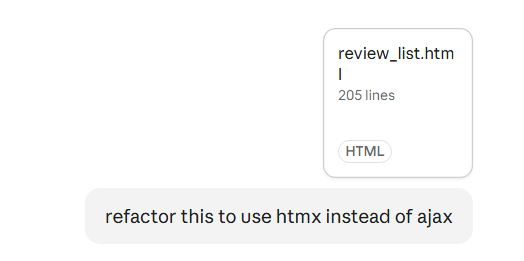
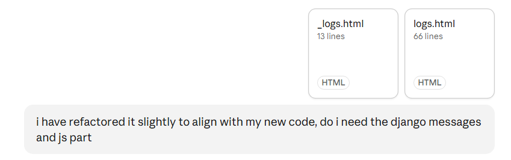
3. Verifikasi code: Aku perlu mastiin code aku bener dan untuk melakukan itu saya menanya Claude:
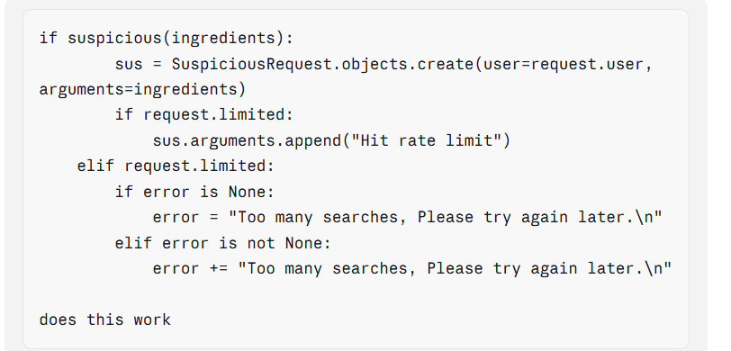
4. SQL: Saat aku membuat model User custom itu membuat banyak masalah DB dan Claude membantu aku dengannya
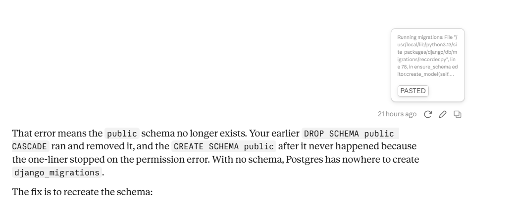

AI sangat membantu saat pembuatan code tetapi kalau permintaannya tidak lengkap akan dihasilkan hal yang diasumsikan oleh AI-nya
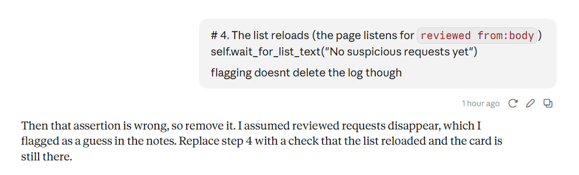
Meskipun bisa bantu, kita masih perlu mengetahui apa yang kita lakukan biar AI-nya bisa menghasilkan hasil yang diinginkan

Chat lengkap: https://claude.ai/share/b37f8d67-e044-4c84-9ee4-248e4861c4c6
